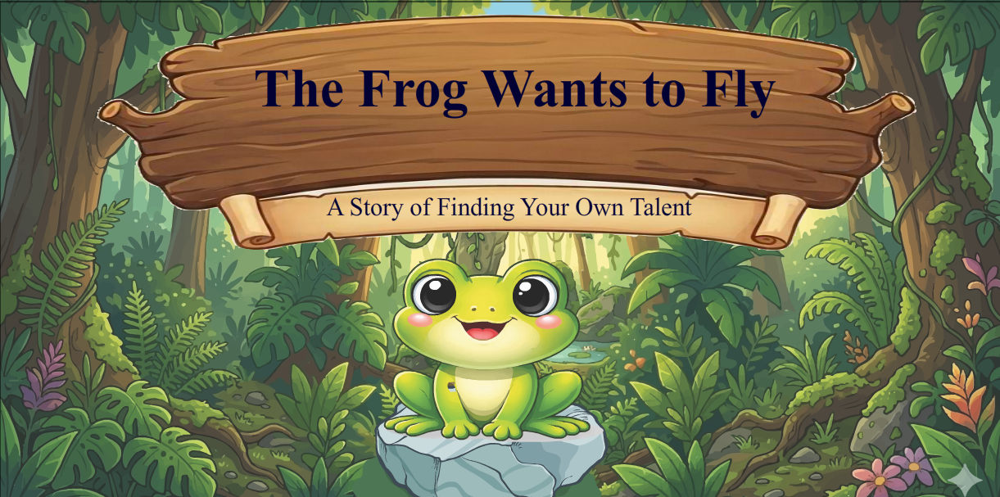

#  The Frog Wants to Fly
### A Story of Finding Your Own Talent

## Project Overview

**The Frog Wants to Fly** is an original 2D animation project created using Adobe Animate. It tells an inspiring story about a little frog who dreams of flying like the birds.

Through different experiences and challenges, the frog discovers that everyone has their own unique abilities and special talents.

The story encourages viewers to believe in themselves and appreciate their individual strengths.

## Story Summary

A little frog watches birds flying in the sky and dreams of flying too.

When the frog tries to fly, it faces difficulties and learns that flying is not its natural ability. Through an unexpected experience, the frog discovers its own special talent.

The story delivers an important message:

**"Everyone has their own special talent."**

## Storyboard

The animation was planned using an original hand-drawn storyboard consisting of 12 scenes.

## Tools Used

- Adobe Animate – 2D Animation
- Adobe Illustrator – Visual Assets and Artwork

## Project Files

| File | Description |
|---|---|
| `THE FROG WANTS TO FLY.fla` | Adobe Animate source project |
| `Animation Storyboard.jpeg` | Original hand-drawn storyboard |
| `The-Frog-Wants-to-Fly-cover.png` | Animation cover image |

**Note:** The Adobe Animate source file is stored using Git Large File Storage (Git LFS).

## Project Highlights

- Original story concept and storyboard
- 2D character animation
- Scene design and transitions
- Visual storytelling
- Creative use of digital illustrations

## Developer

Created as an individual 2D animation project.

**GitHub:** [kavindyachathurangi2002](https://github.com/kavindyachathurangi2002)

---

*The Frog Wants to Fly – Everyone has their own special talent.*
